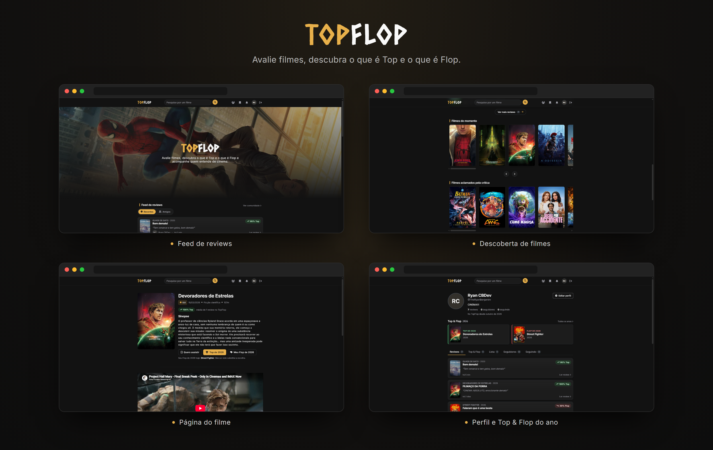
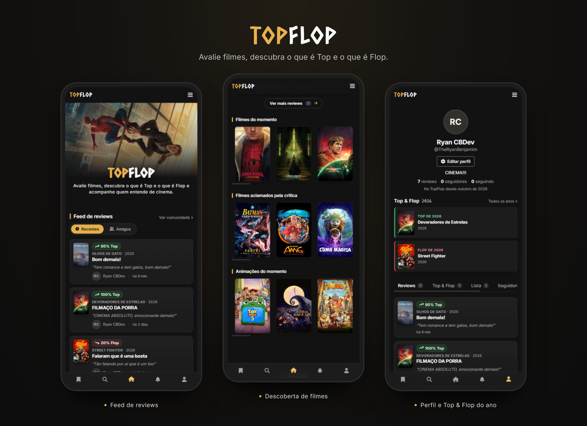
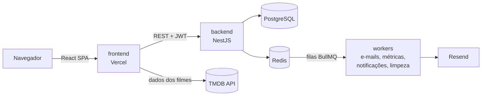

<h1 align="center">TopFlop</h1>

<p align="center">
  Avalie filmes, descubra o que é <strong>Top</strong> e o que é <strong>Flop</strong>.<br>
  Uma rede social para cinéfilos: reviews com nota em porcentagem, seguidores, curtidas, comentários e o seu Top & Flop de cada ano.
</p>

<p align="center">
  <a href="https://topflop.vercel.app"><strong>topflop.vercel.app</strong></a>
</p>

<p align="center">
  
</p>

<p align="center">
  
</p>

---

## Sobre o projeto

No TopFlop, cada pessoa dá uma nota em porcentagem para os filmes que assistiu. A partir de 50% o filme é **Top**; abaixo disso, é **Flop**. A média de todas as reviews vira a nota do filme na plataforma.

Além das reviews, dá para:

- **Seguir pessoas** e ver um feed só com as reviews de quem você segue
- **Curtir e comentar** reviews, e curtir comentários
- **Escolher o Top e o Flop do ano**: o melhor e o pior filme que você viu em cada ano, com histórico
- **Montar uma lista** dos filmes que você quer assistir
- **Receber notificações** quando alguém te segue, curte, comenta ou quando quem você segue publica uma review
- **Descobrir filmes** em alta, aclamados pela crítica e animações, e buscar qualquer título

Os dados dos filmes (título, pôster, sinopse, trailer) vêm do [TMDB](https://www.themoviedb.org/). O banco do TopFlop guarda só o `tmdbId` e as métricas calculadas a partir das reviews.

## Como está organizado

Este repositório tem duas aplicações:

| Pasta | O que é | Stack |
| --- | --- | --- |
| [`frontend/`](./frontend) | SPA responsiva, com layout de desktop e de celular | React 19, TypeScript, Vite, React Router, CSS Modules |
| [`backend/`](./backend) | API REST com autenticação, filas e e-mails | NestJS 11, TypeScript, PostgreSQL, Prisma, Redis, BullMQ, Resend |



O frontend busca os dados dos filmes direto no TMDB e as informações sociais (reviews, perfis, curtidas etc.) na API. A API só conhece o `tmdbId` dos filmes.

O que não precisa acontecer durante a requisição (enviar e-mail, recalcular a nota de um filme, criar notificações, apagar tokens vencidos) roda em segundo plano nas filas do BullMQ.

Cada pasta tem seu próprio README com os detalhes:

- **[backend/README.md](./backend/README.md)**: módulos, endpoints, filas, banco de dados e variáveis de ambiente
- **[frontend/README.md](./frontend/README.md)**: rotas, estrutura de pastas e integração com a API e o TMDB

## Rodando localmente

### Pré-requisitos

- Node.js 20.19 ou mais recente (exigido pelo Vite 7)
- PostgreSQL
- Docker (para subir o Redis), ou um Redis já instalado
- Uma chave da [API do TMDB](https://www.themoviedb.org/settings/api)
- Uma chave do [Resend](https://resend.com) para o envio de e-mails

### 1. Backend

```bash
cd backend
npm install
docker compose up -d          # sobe o Redis na porta 6379
# crie o .env (veja backend/README.md)
npx prisma migrate dev        # cria as tabelas e gera o Prisma Client
npm run start:dev             # API em http://localhost:3000
```

### 2. Frontend

Em outro terminal:

```bash
cd frontend
npm install
cp .env.example .env          # preencha VITE_TMDB_API_KEY
npm run dev                   # app em http://localhost:5173
```

Em desenvolvimento, o frontend chama `/api/...` e o proxy do Vite repassa para a API em `http://localhost:3000`.

## Autor

Feito por **Ryan Costa**.
